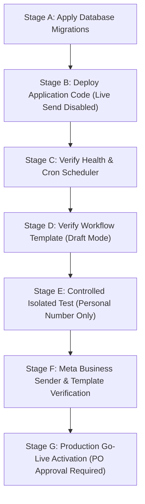

# WACRM Customer Feedback Automation — Staged Deployment Guide

**Document ID:** `DEP-WACRM-FEEDBACK-20261122`  
**Target:** Production Go-Live Deployment  
**Author:** WACRM DevOps & Release Engineering  
**Release Strategy:** Staged 7-Phase Rollout (Stages A through G)

---

## 1. Overview & Release Strategy

To ensure zero downtime, strict tenant isolation, and zero accidental customer messaging, the Customer Feedback Automation deployment is divided into seven controlled, sequential stages.

**Golden Rule:** No customer-facing message sending may be enabled until Stage G is explicitly authorized.

---

## 2. Staged Deployment Protocol



---

### Stage A: Apply Database Migrations
**Objective:** Create required schema tables, constraints, RLS policies, and RPC functions in Supabase.

1. **Preflight:** Run database backup snapshot in Supabase dashboard.
2. **Execute Migrations in Order:**
   - `supabase/migrations/202611220003_restaurant_feedback_and_outbox_schema.sql`
   - `supabase/migrations/202611220004_customer_feedback_workflow_template.sql`
3. **Verify Post-Migration:**
   - Execute verification queries from [docs/customer-feedback-migration-plan.md](file:///c:/Users/tanve/wacrm-for-the-illusion-cafe-restro/docs/customer-feedback-migration-plan.md).
   - Ensure table `restaurant_order_outbox_events` and `restaurant_feedback_dispatch_ledger` exist with RLS enabled.
   - Confirm workflow `customer-feedback-automation` is in `'draft'` status.

---

### Stage B: Deploy Application Code (Live Sending Disabled)
**Objective:** Ship verified TypeScript code to Vercel production.

1. **Environment Flag Verification:**
   - Ensure `BACKEND_FLOWS_ENABLE_LIVE_SEND` is set to `false` or unset in Vercel project environment variables.
   - Ensure `BACKEND_FLOWS_ENABLE_TEST_SEND` is set to `true` (restricted to authorized personal test number).
   - Ensure `AUTOMATION_CRON_SECRET` is configured.
2. **Deploy to Vercel:**
   - Push commit to `main` branch or trigger deployment via Vercel CLI / Dashboard.
3. **Verify Build Output:**
   - Verify zero build warnings or runtime crashes.
   - Verify all 57 Next.js static/dynamic routes build successfully.

---

### Stage C: Verify Health & Cron Scheduler
**Objective:** Confirm backend cron endpoint authenticates and sweeps correctly.

1. **Test Cron Endpoint:**
   ```bash
   curl -X GET "https://<your-wacrm-domain>/api/backend-flows/cron" \
     -H "x-cron-secret: $AUTOMATION_CRON_SECRET"
   ```
2. **Verify Response:**
   ```json
   {
     "success": true,
     "processed": 0,
     "reclaimed": 0,
     "skipped": 0,
     "errors": [],
     "outbox": {
       "scanned": 0,
       "dispatched": 0,
       "failed": 0
     }
   }
   ```
3. **Activate external cron on cron-job.org:**
   - Enable the existing 1-minute cron job targeting `/api/backend-flows/cron`.

---

### Stage D: Verify Workflow Template (Draft Mode)
**Objective:** Inspect the automation canvas in WACRM Dashboard.

1. Navigate to `https://<your-wacrm-domain>/backend-flows`.
2. Open workflow `customer-feedback-automation`.
3. Confirm 5-node pipeline is configured:
   - Node 1: Order Completed Trigger (`order.completed`)
   - Node 2: Feedback Eligibility Check (`restaurant_feedback_eligibility`)
   - Node 3: Delay Timer (20 minutes)
   - Node 4: Pre-Send Revalidation (`restaurant_feedback_revalidation`)
   - Node 5: WhatsApp Feedback Message (`whatsapp_message`)
4. Confirm status badge displays **DRAFT**. Do not click "Publish".

---

### Stage E: Controlled Isolated Test (Personal Number Only)
**Objective:** Verify end-to-end execution path using the developer's authorized test number.

1. Create a controlled test order in the restaurant trial interface with `contact.phone` set to the developer's authorized WhatsApp number.
2. Ensure the order has `is_test_order = false` in the test harness fixture (or run simulator test run).
3. Transition order to `completed`.
4. Inspect run trace at `/backend-flows/<id>`:
   - Eligibility passes.
   - Execution pauses on 20-minute delay node (status: `waiting`).
   - Advance or sweep delay run.
   - Pre-send revalidation passes.
   - Message received on personal WhatsApp device.
   - Webhook updates ledger status to `delivered`.

---

### Stage F: Meta Business Sender & Template Verification
**Objective:** Verify genuine business number connection and approved templates.

1. In Meta WhatsApp Business Manager (WABA):
   - Verify phone number registration and set up 2FA PIN.
   - Connect number in WACRM Dashboard under Settings → WhatsApp Config.
   - Confirm status changes to `connected` and `registered_at` is populated.
2. In Meta Template Manager:
   - Ensure an approved feedback template exists (e.g. `customer_feedback_request`).
   - Category MUST be `MARKETING` (or compliant with Meta Business Messaging policy).
   - Sync templates in WACRM: Settings → WhatsApp Templates → Sync.

---

### Stage G: Production Go-Live Activation (PO Approval Required)
**Objective:** Enable genuine customer messaging.

1. Obtain explicit Product Owner approval.
2. Set Vercel environment variable:
   ```env
   BACKEND_FLOWS_ENABLE_LIVE_SEND=true
   ```
3. Open workflow canvas and click **Publish**.
4. Monitor initial completed orders in execution trace and delivery ledger.
